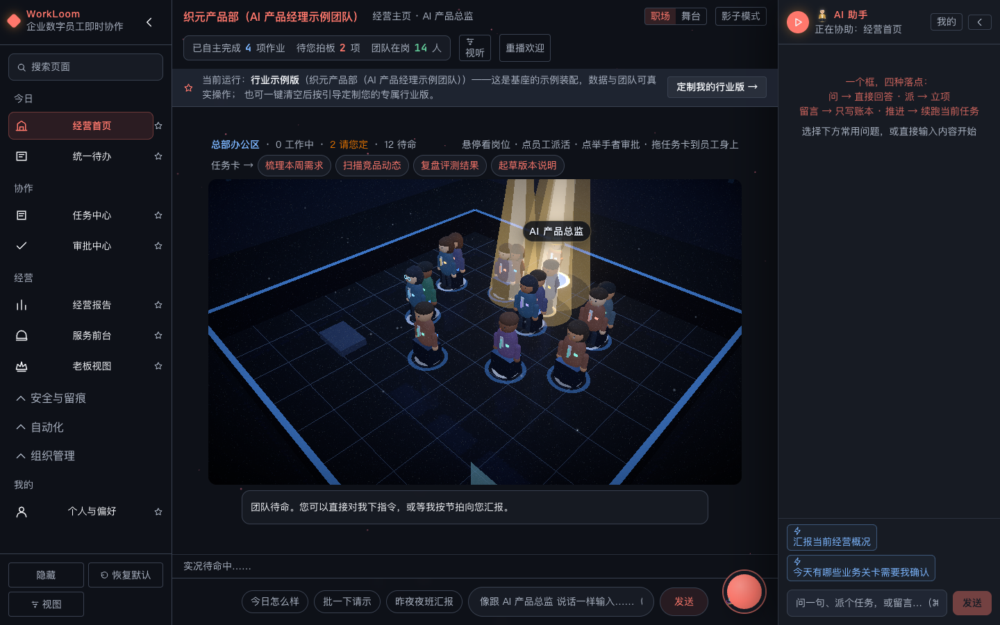
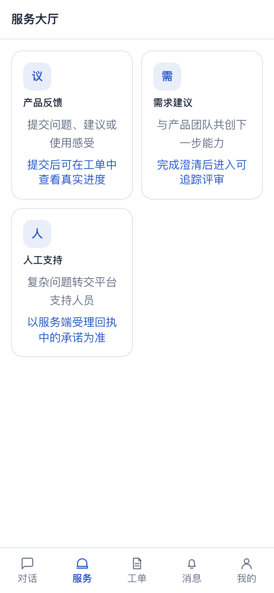
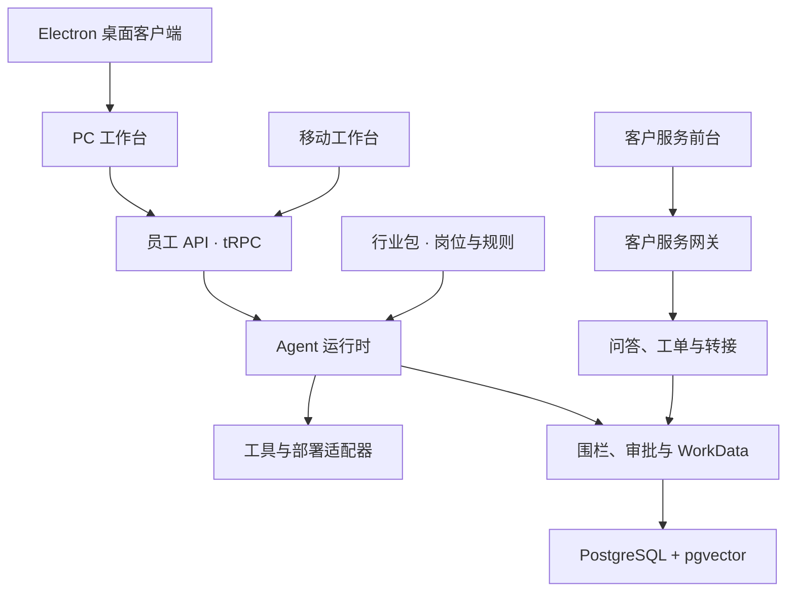
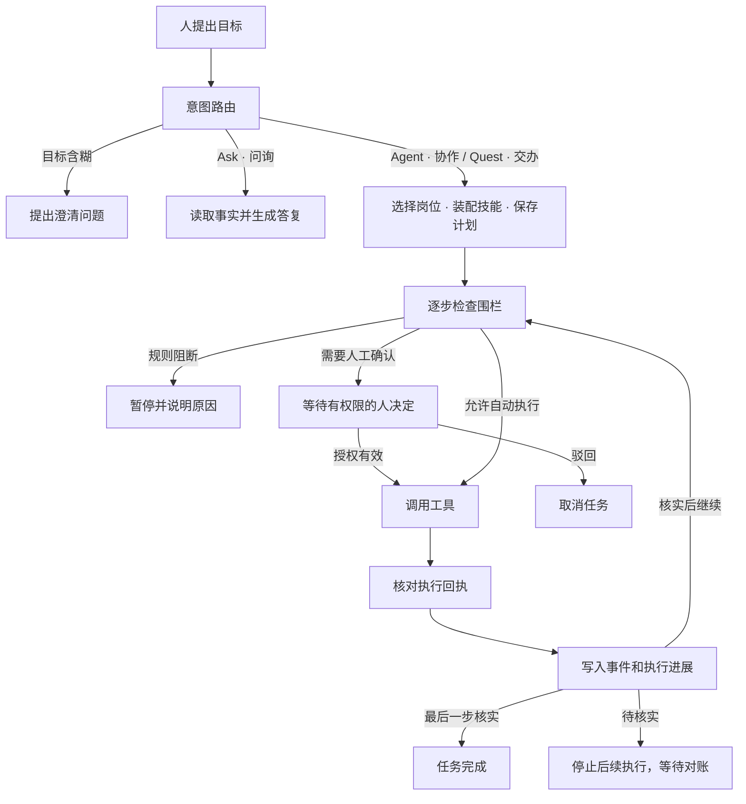

# WorkLoom IM · 织元

**一个让人和 AI 数字员工一起工作的组织工作台。**

WorkLoom IM 把对话、任务、审批和工作记录放进同一个工作区。你可以向数字员工查问现状、和它商量下一步，也可以把一项有明确目标的工作交给它执行。回到工作台时，你能看到是谁接手了任务、进展到了哪一步、哪些决定需要你做，以及结果有没有回执。

[English](README_EN.md) · [查看演示](#界面预览) · [本地体验](#本地体验) · [阅读源码](#从哪里读代码) · [AI Agent 指引](#六开发者与-ai-coding-agent-指引)

## 用它做什么

| 场景 | 人怎么参与 | 系统留下什么 |
| --- | --- | --- |
| **交办一项工作** | 在对话里描述目标，补充约束，查看由哪个岗位接手 | 任务记录、执行计划、步骤进展与结果 |
| **审批一项有风险的动作** | 查看规则命中、提案和上下文，选择批准、修改或驳回 | 审批决定、理由及后续执行回执 |
| **交接与复盘** | 查看夜班和统一待办，处理仍需决策的事项，按任务追溯事件 | 任务状态、业务事件与可回溯的组织记忆 |
| **接待客户** | 让客户从移动服务前台咨询或提交工单，由团队接手需要人工处理的需求 | 服务会话、工单和处理进度 |

本仓是 WorkLoom 的**公共基座**，默认示例是 **AI 产品经理工作区**。行业包（Bundle）把岗位、技能、围栏规则和三端界面配置装配到工作区，AI 产品经理示例展示需求澄清、PRD 草稿、评测准备和发布检查。酒店示例则用自己的岗位、规则和服务内容演示同一套基座能力。

## 界面预览

当前源码在本机运行的浏览器界面。数据来自 AI 产品经理演示种子，应答使用离线模拟模型。




[浏览更多功能和界面](docs/capabilities.auto.md) · [三端体验清单](PREVIEW_CHECKLIST.md)

## 系统如何组成

桌面客户端是正式产品入口。PC 工作台、移动工作台和客户服务前台共享界面组件。员工工作台通过 tRPC 访问服务，客户前台走独立的服务网关。行业包为工作区装配岗位和规则，运行时负责把目标交给对应的岗位和工具。



相关实现见[服务入口](apps/server/src/index.ts)、[Agent 运行时](packages/runtime/src)、[行业包](bundles)和[工作区数据库上下文](packages/db/src/client.ts)。

## 一项工作如何推进

例如，你在工作台输入「整理本周客户反馈，给出三个优先处理的问题」。系统先判断你是在问一个问题、希望逐步确认，还是要交办一整项工作。需要执行的任务会根据工作区的岗位和技能装配计划，逐步检查规则。只读问询会用当前可取得的事实组织答复。



WorkData 的业务事件记录执行者、工作区上下文、业务对象、决定和规则影响，可附执行回执。事件以追加方式写入，哈希链可用于校验。Agent 协作模式的每个可执行步骤都需要人工确认。Quest 可以自动推进规则放行的步骤。已核实且指纹相同的步骤可以在续跑时跳过。真实外部动作依赖相应工具适配器和有效回执，演示回执会标记为模拟。

[意图路由](packages/runtime/src/intent.ts) · [任务执行与续跑](packages/runtime/src/loop.ts) · [事件字段](packages/shared/src/event-schema.ts)

## 本地体验

**想看看桌面版。** 在 [GitHub 桌面发行页](https://github.com/geniusdapeng-collab/workloom-im/releases/tag/v2.2.23) 按操作系统和 CPU 架构挑选安装包。同一发行记录附有校验表与发布清单。

**想用源码体验三端。** 准备 Node.js 24、仓库声明的 pnpm 版本和 Docker Compose。请使用独立的本地演示环境，并预留端口 3000–3002、8787、5173 和 5176。

```bash
git clone https://github.com/geniusdapeng-collab/workloom-im.git
cd workloom-im
pnpm setup --skip-computer
LLM_PROVIDER=mock IM_DRIVER=mock pnpm preview:all
```

| 入口 | 本地地址 | 视角 |
| --- | --- | --- |
| PC 工作台 | `http://localhost:3000` | 团队成员、数字员工、任务与决策 |
| 移动工作台 | `http://localhost:3001` | 员工和负责人随身查看待办与进展 |
| 移动服务前台 | `http://localhost:3002` | 客户咨询与工单 |

预览使用本地 PostgreSQL 和演示种子，不需要模型密钥。按 `Ctrl+C` 停止预览。源码桌面端使用 `pnpm app`。

[环境与预览命令](package.json) · [演示数据口径](mock/README.md) · [首次接入指南](docs/02-新客户首次接入完整流程.md)

数字员工名册展示岗位与职责，织伴提供桌面对话入口。模型路由根据场景选择推理配置，技能中心管理工作区可复用的能力，考试院用样例与红线验证数字员工的表现。详见[用户功能清单](docs/03-功能清单-用户版.md)。

## 从哪里读代码

| 想了解 | 从这里开始 |
| --- | --- |
| 桌面和三端界面 | [Electron](apps/desktop/electron)、[PC](apps/web)、[移动工作台](apps/webb)、[客户前台](apps/webc)、[共享组件](packages/ui) |
| 一句话如何变成任务 | [派遣入口](apps/server/src/trpc/router.ts)、[线程装配](apps/server/src/runtime/thread-runner.ts)、[运行时](packages/runtime) |
| 权限、审批和事件如何协作 | [围栏](packages/base/fence-engine)、[审批](packages/base/review-console)、[WorkData](packages/base/workdata)、[数据库迁移](packages/db/migrations) |
| 如何把底座装进一个行业场景 | [AI 产品经理示例](bundles/ai-pm/bundle.json)、[行业包契约](packages/industry-contract)、[落地向导](docs/04-行业落地向导-用户版.md) |

[用户功能清单](docs/03-功能清单-用户版.md) · [架构决策](docs/DECISIONS.md) · [更新记录](CHANGELOG.md) · [原版项目介绍](https://github.com/geniusdapeng-collab/workloom-im/blob/e5d76398484cac7d8ac50b6c27905765a59fd50f/README.md)


<!-- WORKLOOM-AUTONOMOUS-OPERATIONS:BEGIN -->
## 🧭 理论纲领 · AI 自主经营模式

> **客户购买的不是工具，而是一家正在运行的公司。**
> 本仓是 WorkLoom「AI 自主经营」体系的一部分；完整纲领《AI 自主经营纲领——论一个新经营范式的诞生》见 **[AI-AUTONOMOUS-OPERATIONS.md](AI-AUTONOMOUS-OPERATIONS.md)**。

- **成本结构翻转**：人类公司的管理动作，是为"人不可靠"支付的三种对冲税（激励 / 层级 / 监督）；AI 自治退掉这笔税，转而为 **边界定义 + 持续评测** 付费。
- **三个翻转**：管理对象从动机 → **边界**；经营动作从传递信息 → **分配注意力**；行业 knowhow 从"人在经验在" → **可计量资产**。
- **责任不可自动化**：AI 不能坐牢、不能赔钱。围栏 / 人审 / 汇报 / 事件账本构成的治理层，是自治的**对价**，不是限制器。
- **终态判据**：没有客户操作，这件事还会不会发生？"开箱即用"不够——终态是 **没开箱就在运营**：首次登录看到的是已经跑出来的业务进展与第一份汇报。
- **自治权是挣来的**：观察 → 请示后执行 → 汇报后执行 → 全权自治，按决策域用回测证据升降档；汇报透明是自治的价格标签。
- **度量即货币**：自治率、客户干预率、回测命中率三条曲线决定自治权扩张；模拟成功不计入自治率。
<!-- WORKLOOM-AUTONOMOUS-OPERATIONS:END -->

<!-- CAPABILITIES:BEGIN -->
<!-- 本区块由 scripts/generate-capabilities.mjs 自动生成（2026-10-05），请勿手改；重跑 pnpm capabilities 更新 -->

## 🧩 系统能力速览（自动生成 · 与代码同步）

> 以下为源码目录与入口清单；实际调用及结果状态见能力导览的独立证据字段，未验证项不能作交付承诺。

- 🖥 **三端应用入口**：PC 端 · B 端工作台 · 移动端 · B 端高保真 · 移动端 · C 端 AI 服务前台
- 🏨 **行业 Bundle（垂直能力包）**：bundles/ai-pm/ · bundles/hotel/ · bundles/platform/
- 🧑‍💼 **数字员工与数字人（本仓自带）**：数字员工中心（`/agents`） · 织伴数字人（Live2D 常驻浮层） · 语音与口型引擎 · Live2D 渲染后端与资产
- 🖐 **操作电脑能力（本仓自带 · 可装生产工作站）**：computer-use 三层感知入口 · HTTP 远程驱动 + MCP server
- 🤖 **AI 自动化引擎（系统内置能力）**：围栏 DSL 引擎 · 技能保鲜环（下行分发） · L2 编排（ASK/QUEST） · 夜班自动运行 · 模型路由 · 五元事件 + RLS 隔离 等 10 项
- ✅ **验证与质量（工程纪律）**：一键安装（bootstrap） · 主测试套件 · 发布门禁 · 五元事件验链 · Agent 能力巡游 · 环境自检
- 🎁 **演示与交付资产**：高保真演示页 ×6 · 官网静态站 · 自带技能 ×5 · 能力导览 PPT · Mock 数据体系

> 📖 完整能力导览（含截图与体验路径）：[docs/capabilities.auto.md](docs/capabilities.auto.md) ｜ 🤖 AI Agent 入口：[AGENTS.md](AGENTS.md) ｜ 🎯 首启必跑：`pnpm preview:all`
<!-- CAPABILITIES:END -->

## 六、开发者与 AI Coding Agent 指引

> **AI Coding Agent**：进仓先读 [`AGENTS.md`](AGENTS.md) 与 [`.ai-prompt`](.ai-prompt)；全量能力清单见 [`docs/capability-map.md`](docs/capability-map.md)；一键能力自检 `pnpm agent:tour`；浏览器自动化指南 [`docs/agent-computer-guide.md`](docs/agent-computer-guide.md)。
> **🖐 操作电脑能力（本仓自带 · 可装生产）**：`packages/base/computer-use/` 65 动作三层感知，`pnpm computer:preflight && pnpm computer:smoke` 即验；专用工作站一键安装 + HTTP/MCP 远程驱动见 [`docs/computer-use-production.md`](docs/computer-use-production.md)。

### 6.1 仓库地图（pnpm monorepo）

| 路径 | 职责 |
|---|---|
| `packages/base/workdata` | **核心底座**：安全网关 / 五元事件库 / PII 脱敏 / 组织记忆与检索 |
| `packages/base/{fence-engine,review-console,im-channels,night-shift,inspection,skills,tenancy,bundles,model-router}` | 九域能力：围栏判定 / 审批流 / IM 通道 / 夜班调度 / 巡检 / 技能市场 / 多租户与演示 JWT / 行业 Bundle / 模型路由 |
| `packages/runtime` | dsh seam 适配：意图路由（Ask/Agent/Quest 三模式）、Quest 循环（replay 断点续跑）、装配 |
| `packages/{shared,db}` | 五元 zod schema / 手写 SQL 迁移（DDL 事实源） |
| `apps/{server,web,webc,site,desktop}` | Hono+tRPC 服务 / 工作台 PC 前端 / C 端 H5 / 官网 / Mac 桌面包 |
| `packages/base/wizard` | **行业落地向导**：首次装机的状态机与编排（技能一/二/三→交付配置），行业内容零预置（D18） |
| `skills/official/` | 官方套件：`industry-entry/`（行业落地四技能+快速上线模板）、`product-feedback/`（反哺分析技能）（D17） |
| `vendor/{dsh,dsh-im}` | dsh 0.1.6-alpha.2 审计基线（只读）/ dsh IM 通道插件（MIT 回馈） |
| `scripts/` | migrate / seed / demo / verify-chain / **suite（371 场景用例）** / dsh-gate |

### 6.2 最小跑通路径

环境：Node 24 LTS（corepack 自带 pnpm 10）+ PostgreSQL 17 + pgvector 0.8（`docker compose up -d postgres` 一条命令就绪）。

```bash
git clone https://github.com/workloom-ai/workloom-im.git
cd workloom-im
corepack enable && pnpm install && cp .env.example .env

# 数据库初始化（建库建扩展即可；migrate 自动创建 app/gateway 双角色并完成授权——
# A3 旁路防控：只有 gateway 角色可 INSERT biz_events）
psql -U postgres -c "CREATE DATABASE workloom;"
psql -U postgres -d workloom -c "CREATE EXTENSION vector;"
pnpm db:migrate && pnpm db:seed   # 17 个迁移 + 演示种子（种子幂等可复跑）

# 质量门禁（与 CI ci-gate 完全同口径）
pnpm typecheck         # 全仓类型检查
pnpm test              # vitest 168 例（base 152 + runtime 12 + shared 4）
RUN_DB_TESTS=1 pnpm -C packages/base test   # PG 集成测试（默认 skip）
pnpm db:verify-chain   # 哈希链全库重算（篡改检测）
pnpm suite             # 371 条全场景用例（服务层 344 + HTTP E2E 27）
pnpm demo              # 端到端演示剧本
pnpm doctor            # 环境自检

# 日常开发
pnpm dev               # server(:8787) + web(:5173)
pnpm app               # 源码 server/web + Electron 桌面窗口；不需要 dist-payload
pnpm app:dev           # 同一源码桌面入口，web 使用 HMR
pnpm app --smoke       # 无头验证源码服务与 Electron 主进程；不代替安装包渲染冒烟
```

`dist-payload/` 与 `dist-payload.tar.gz` 是安装包流水线产物，只在 `app:pack` / `app:dist` 之前按目标平台装配。正式安装包的后端首启与 `WORKLOOM_RENDER_SMOKE=1` 真实窗口验收始终从安装包 Resources 读取并校验完整载荷；源码启动不会伪造或复用这条发布路径。

### 6.3 真实模型接入（三模式真实运行态）

三种交互模式（ask 问询 / agent 逐步商量 / quest 自主执行）默认以确定性 mock 运行（D4 全流程可跑）；配置真实模型后全链真实化——意图分类（B8）、任务规划（B9）、ask 应答合成三环均走真实模型推理，模型出站强制脱敏（L6.2）：

```bash
# .env
LLM_PROVIDER=openai            # 任意 OpenAI 兼容端点（DeepSeek/月之暗面/智谱/OpenAI…）
LLM_BASE_URL=https://api.deepseek.com/v1
LLM_API_KEY=sk-xxx
LLM_MODEL=deepseek-chat
```

行业化落地经「落地向导」自动化完成（D18/D20）：写 LLM_* 四 env + `registerAskFactProvider` 注册行业事实面 + 装载行业 bundle（六槽），代码零改动即真实运行。

### 6.4 客户旅程模式（先体检，再托管）

底座为行业落地定义标准旅程——新客户从「质检模式（Audit-Only）」起步：只读接入数据源 → **快照快扫**（15–30 分钟当场出《快速体检报告》，由 `@workloom/audit-core` 引擎 + 行业分析器算出真实发现）→ 持续体检（1–2 周）→ 影子模式（3 天）→ 正式托管。围栏纪律：体检期一切写操作物理 block（行业包 audit-only patch），检项由行业 Bundle 定义。

### 6.5 给 AI 助手的修改纪律

- 改网关/权限/RLS/append-only 相关代码前必读 `docs/AUDIT.md` 第 1 轮 P0 教训（RLS 事务级上下文必须配显式事务）
- 每个逻辑变更一个 commit；修复必须附回归测试（往 `scripts/suite.ts` 加用例优先于新建测试文件）
- 改完代码必须跑 `pnpm suite`；发布前必须跑 `pnpm release:gate`（未全过禁止发布，见 `docs/release-checklist.md`）
- **UI 改动必须用浏览器能力实际打开页面截图核对**，禁止「改了就算完成」
- 改了能力面（脚本/包/技能/演示页）必须跑 `pnpm capabilities` 重新生成人类版导览

### 6.6 桌面安装包发布通道（CNB）

仓库事实源在 CNB（GitHub 账号已失效），桌面安装包在 CNB 流水线内构建与发布：

- **流水线**：`.cnb.yml#desktop-release`（触发 `api_trigger_desktop_release`，须以 `DESKTOP_RELEASE_VERSION=vX.Y.Z` 指定版本）。
  编排为 `desktop-release-preflight`（发布输入/资产锁/发布策略/命名一致性）→ `desktop-release-macos`（自托管 mac 节点：签名 Bundle → 载荷装配 → dmg arm64/x64 → 验签+公证+拆包验收）→ `desktop-release-windows`（自托管 windows 节点：同源 PG 运行时 → NSIS exe → 拆包验收）→ `desktop-release-finalize`（回读候选字节逐字节复核 sha512，产出 `WorkLoom-SHA512SUMS.txt` 与 `WorkLoom-release-manifest.json`）。
- **产物名（对外恒定，勿改）**：`WorkLoom-mac-arm64.dmg` / `WorkLoom-mac-x64.dmg` / `WorkLoom-win-x64.exe` + 校验表 `WorkLoom-SHA512SUMS.txt`（sha512）。命名一致性由 `node scripts/desktop-artifact-naming.mjs` 门禁守住（文档 / CNB 流水线 / 发布策略事实源三处口径必须一致）。
- **前置（组织侧一次性）**：接入自托管 mac / windows 构建节点（组织设置 → 构建节点，tags 分别为 `mac,arm64` 与 `windows`），并在仓库密钥注入桌面签名/公证/Bundle 私钥。缺任一项时流水线 fail-closed（预检列出缺项），**不会**产出未签名或半套制品。当前登记：`BLK-B-01-003`（桌面签名与公证密钥未配置）。
- **遗留通道**：`.github/workflows/desktop-production-release.yml` 保留为发布策略事实源（`product.manifest.json#release.workflow` 与 release-publisher-policy 门禁按它校验发布纪律），GitHub 侧不再作为供货通道。

---

## 许可证

[Apache-2.0](LICENSE)。[DeepSeek Harness](vendor/dsh/VENDOR.md) 与仓内 IM 通道插件使用各自的 MIT 许可。
