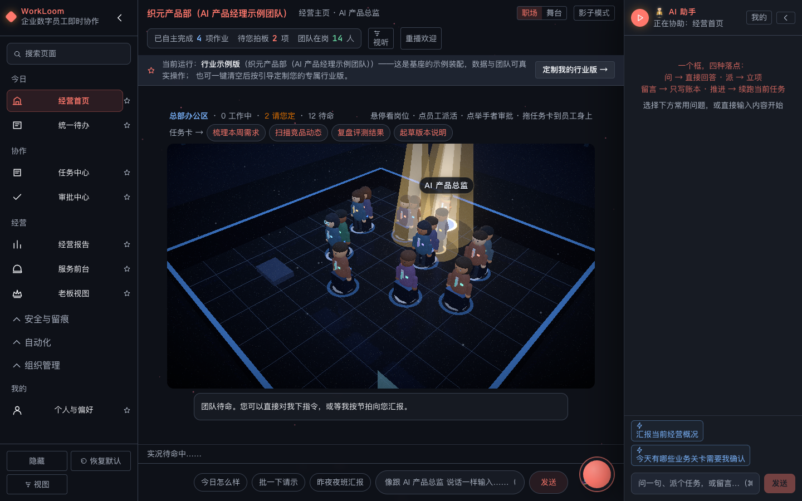
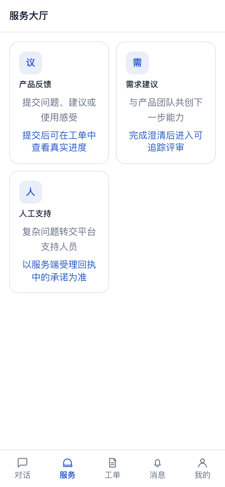
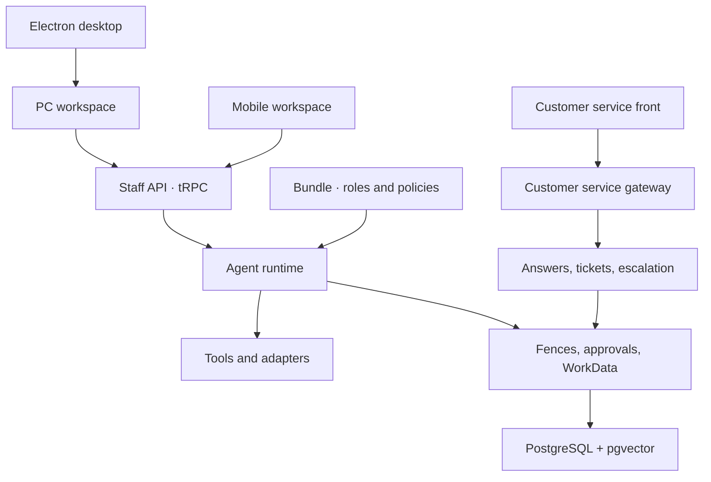
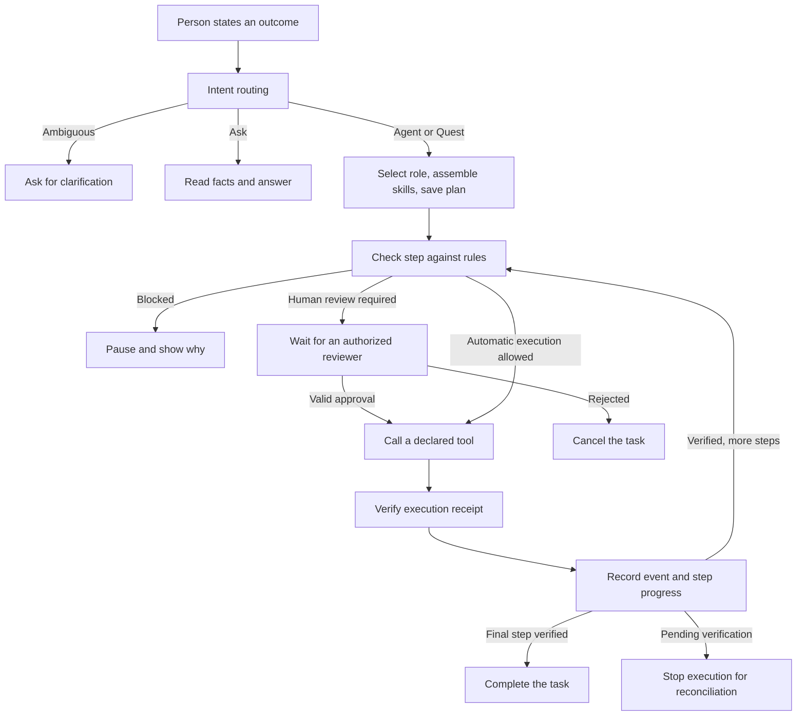

# WorkLoom IM

**A workspace for people and AI agents to work together.**

WorkLoom IM brings conversations, tasks, approvals, and work records into one place. Ask an agent a question, work through a task with it step by step, or assign it an outcome to deliver. The workspace shows who took the task, where it stands, which decisions need your input, and whether the result has a verified receipt.

[简体中文](README.md) · [Screenshots](#see-the-workspace) · [Try it locally](#try-it-locally) · [Explore the code](#explore-the-code) · [AI assistant brief](#-60-second-brief-for-ai-assistants-developeragent-onboarding)

## What teams use it for

| When you need to… | What you do | What WorkLoom records |
| --- | --- | --- |
| **Assign work** | Describe an outcome in a conversation, add constraints, and see which role picks it up | A task, its plan, progress, and outcome |
| **Review a sensitive action** | Inspect the proposal and the rule that flagged it, then approve, edit, or reject it | A decision, its rationale, and any execution receipt |
| **Hand off or review work** | Check pending decisions, see what ran while you were away, and trace a task back to its events | Task state, business events, and attributable organizational memory |
| **Help a customer** | Let customers ask questions or submit tickets through the mobile service front, with staff handling escalations | A conversation, a ticket, and its progress |

This repository contains the **shared WorkLoom foundation** and the default **AI Product Manager** example. A bundle defines the roles, skills, policies, and client configuration for a particular workspace. The AI Product Manager example illustrates clarifying a request, drafting a product requirements document, preparing evaluations, and checking a release. The hotel example uses the same foundation with its own roles, rules, and services.

## See the workspace

Browser views captured from a local run of the source. Data comes from the AI Product Manager demo seed, with responses from a simulated model.




[Capability tour](docs/capabilities.auto.md) · [Client preview checklist](PREVIEW_CHECKLIST.md)

## How it fits together

The Electron desktop client is the primary product entry point. The PC and mobile staff clients use the staff API, while the customer service front uses a separate gateway. Workspaces supply their own roles and rules through bundles.



See the [server entry point](apps/server/src/index.ts), [runtime](packages/runtime/src), [bundles](bundles), and [workspace database context](packages/db/src/client.ts).

## How a task runs

Ask WorkLoom to summarize this week's customer feedback and identify three priorities. It first routes the request to a read-only answer, step-by-step collaboration, or delegated execution. For work that requires execution, it assembles a plan from the workspace's available roles and skills.



WorkData records the actor, workspace context, business object, decision, and policy impact. An event can include an execution receipt. The append-only ledger uses a hash chain for verification, and a resumed task can skip matching steps that already have a verified result. Agent mode requires human confirmation for each executable step. Quest can run steps that the rules allow. External effects depend on deployment adapters and receipts. Demo receipts carry a simulated marker.

[Intent routing](packages/runtime/src/intent.ts) · [Execution and replay](packages/runtime/src/loop.ts) · [Event schema](packages/shared/src/event-schema.ts)

## Try it locally

**Desktop.** Open the [desktop release](https://github.com/geniusdapeng-collab/workloom-im/releases/tag/v2.2.23) and select the build for your operating system and CPU architecture. The release also includes a checksum file and asset manifest.

**Source preview.** Use Node.js 24, the pnpm version declared by the repository, and Docker Compose in a fresh local demo environment. Keep ports 3000–3002, 8787, 5173, and 5176 free.

```bash
git clone https://github.com/geniusdapeng-collab/workloom-im.git
cd workloom-im
pnpm setup --skip-computer
LLM_PROVIDER=mock IM_DRIVER=mock pnpm preview:all
```

| Client | Local address |
| --- | --- |
| PC workspace | `http://localhost:3000` |
| Mobile staff workspace | `http://localhost:3001` |
| Mobile customer service front | `http://localhost:3002` |

The preview uses local PostgreSQL and demo data. No model API key is needed. Press `Ctrl+C` to stop it. Use `pnpm app` to run the source desktop client.

[Scripts and environment requirements](package.json) · [Demo data](mock/README.md) · [First-time onboarding guide](docs/02-新客户首次接入完整流程.md) (Chinese)

The roster shows agent roles and responsibilities. LoomMate provides a desktop conversation entry point. Model routing selects a configuration by scenario, the skill center manages reusable capabilities, and evaluations check behavior against examples and red-line rules. See the [user feature guide](docs/03-功能清单-用户版.md) (Chinese).

## Explore the code

| To see… | Start with… |
| --- | --- |
| The desktop and browser clients | [Electron](apps/desktop/electron), [PC](apps/web), [mobile staff](apps/webb), [customer front](apps/webc), [shared UI](packages/ui) |
| How a request becomes a task | [Dispatch API](apps/server/src/trpc/router.ts), [thread runner](apps/server/src/runtime/thread-runner.ts), [runtime](packages/runtime) |
| How rules, approvals, and events connect | [Fence engine](packages/base/fence-engine), [approvals](packages/base/review-console), [WorkData](packages/base/workdata), [migrations](packages/db/migrations) |
| How to model a new workspace | [AI Product Manager bundle](bundles/ai-pm/bundle.json), [industry contract](packages/industry-contract), [onboarding guide](docs/04-行业落地向导-用户版.md) (Chinese) |

[Architecture decisions](docs/DECISIONS.md) · [Changelog](CHANGELOG.md) · [Previous project overview](https://github.com/geniusdapeng-collab/workloom-im/blob/e5d76398484cac7d8ac50b6c27905765a59fd50f/README_EN.md)


## ⚡ 60-second brief for AI assistants (developer/agent onboarding)

> If you're an AI assistant that just cloned this repo: this section is all you need to get productive — no need to read the whole file.

**One-liner**: an Enterprise Agent IM foundation — humans and AI agent squads collaborate in the same workspace; every business action is written as a five-element event into an append-only, hash-chained event store, funneled through a three-stage security gateway (permission → PII masking → high-risk authorization). Runtime foundation: DeepSeek Harness (`@deepseek-ai/dsh`, vendored at 0.1.6-alpha.2).

**Repo map** (pnpm monorepo):

| Path | Role |
|---|---|
| `packages/base/workdata` | **Core foundation**: security gateway / five-element event store / PII masking / organizational memory & recall |
| `packages/base/{fence-engine,review-console,im-channels,night-shift,inspection,skills,tenancy,bundles,model-router}` | Nine capability domains: fence engine / approvals / IM channels / night shift / inspection / skill marketplace / tenancy & demo JWT / industry bundles / model router |
| `packages/runtime` | dsh seam adapters: intent routing (Ask/Agent/Quest), Quest loop (replayable, crash-resumable), preset assembly |
| `packages/{shared,db}` | Five-element zod schemas / hand-written SQL migrations (DDL source of truth) |
| `apps/{server,web,site,desktop}` | Hono+tRPC server / bridge web UI / website / Mac desktop bundle |
| `vendor/{dsh,dsh-im}` | dsh 0.1.6-alpha.2 audit baseline (read-only) / dsh IM channel plugin (MIT, contributed back) |
| `scripts/` | migrate / seed / demo / verify-chain / **suite (371 scenario cases)** / dsh-gate |

**Shortest path to green** (Linux/macOS; requires PostgreSQL 17 + pgvector on 5432):

```bash
corepack enable && pnpm install && cp .env.example .env
# Create DB + extension (migrate auto-creates the app/gateway roles and grants —
# A3 anti-bypass: only the gateway role may INSERT into biz_events)
psql -U postgres -c "CREATE DATABASE workloom;"
psql -U postgres -d workloom -c "CREATE EXTENSION vector;"
pnpm db:migrate && pnpm db:seed   # 5 migrations + demo seed (service-store demo workspace)
pnpm typecheck && pnpm test       # typecheck + vitest 168 (DB integration below)
pnpm db:verify-chain              # full hash-chain recomputation
pnpm suite                        # 371 scenario cases (incl. HTTP E2E with a real spawned server)
pnpm demo                         # end-to-end demo play
pnpm dev                          # server(:8787) + web(:5173)
# DB integration tests (skipped by default):
RUN_DB_TESTS=1 pnpm -C packages/base test
```

**Fit / not a fit**:
- ✅ Fit: **a general-purpose agent collaboration foundation** — any organization with clear output metrics and lots of repetitive handling: service businesses (F&B/retail/local services), **social-media marketing teams** (topic planning / copywriting / scheduling / engagement / review), **AI video & content-creation teams** (scripts / storyboards / assets / publishing / comment ops); teams that need AI agents inside the org, on the production line, and under accountability. Domain capabilities load as pluggable bundles; `bundles/` ships a service-store reference implementation.
- ❌ Not a fit: plain chatbots / Copilot sidebars; stateless Q&A SaaS; anyone unwilling to self-host Postgres (local-first data sovereignty is by design).

**Source-of-truth docs**: [`CHANGELOG.md`](CHANGELOG.md) releases · [`docs/DECISIONS.md`](docs/DECISIONS.md) ADRs · [`docs/AUDIT.md`](docs/AUDIT.md) audit history · [`docs/SUITE.md`](docs/SUITE.md) 371-case list · [`docs/03-功能清单-用户版.md`](docs/03-功能清单-用户版.md) full feature list (中文).

**Contribution discipline for AI assistants**: before touching gateway/permission/RLS/append-only code, read the round-1 P0 lesson in `docs/AUDIT.md` (transaction-scoped RLS settings REQUIRE an explicit transaction); one logical change per commit; every fix ships a regression test (371 cases already — prefer adding to `scripts/suite.ts` over new test files).


---

## License

[Apache-2.0](LICENSE). [DeepSeek Harness](vendor/dsh/VENDOR.md) and the bundled IM channel plugin each use their own MIT license.
